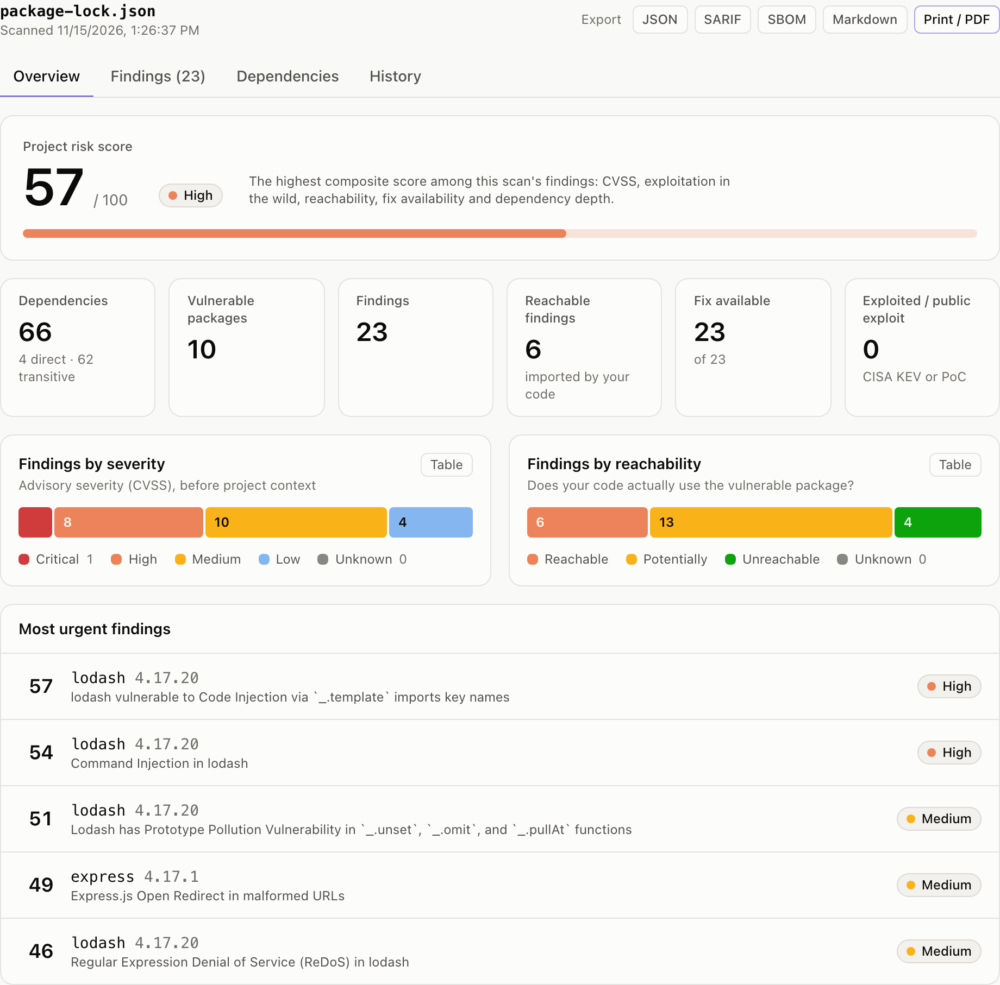
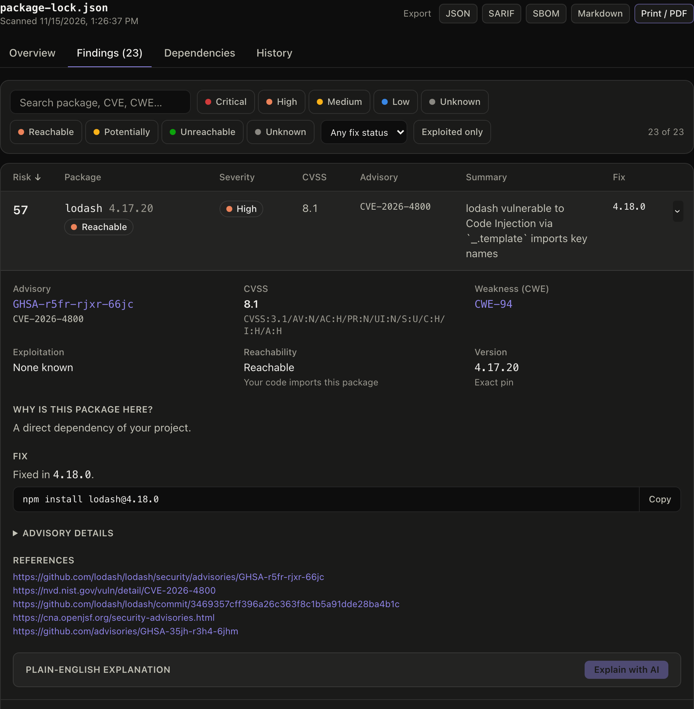
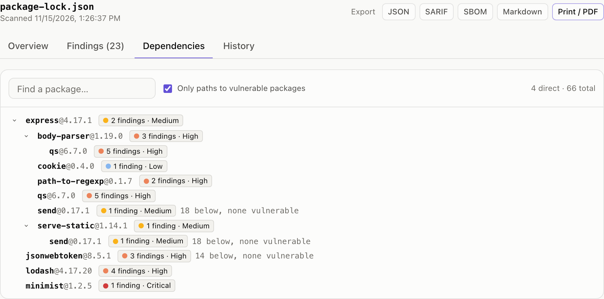

# Soteria-AI 🛡️

**AI-Powered Dependency Risk Analyzer**

[](https://github.com/marvelcodeX/project-dependency-risk-analyzer/actions/workflows/ci.yml)
[](https://github.com/marvelcodeX/project-dependency-risk-analyzer/actions/workflows/dependency-scan.yml)
[](LICENSE)

Soteria-AI scans your project's dependencies for known vulnerabilities and uses a local LLM to explain the risks in plain English — so you don't need to be a security expert to understand what's wrong and how to fix it.



## What Makes It Different

| Feature | Traditional Scanners | Soteria-AI |
|---------|---------------------|-----------|
| CVE detection | ✅ | ✅ |
| Plain-English explanations | ❌ Raw CVE text | ✅ AI-generated |
| Privacy | Cloud-based | ✅ Runs locally (Ollama) |
| Smart prioritization | CVSS only | ✅ CVSS + exploit status + reachability + dependency depth |
| Beginner-friendly | ❌ | ✅ Designed for developers, not security experts |

## Features

**Available now**

- 🔍 **Dependency Scanning** — Python `requirements.txt` (pins, ranges, extras, env markers, hashes), npm `package.json` / `package-lock.json` (full transitive tree), Go `go.mod` (with `replace`), Maven `pom.xml` (with `${property}` resolution). Format is auto-detected from the filename or content
- 🌐 **Dependency Graph** — direct vs transitive packages, depth, and "why is this here?" paths from npm lockfiles (plus `// indirect` in go.mod)
- 🛡️ **Vulnerability Lookup** — OSV, with CVSS scoring, CWE weakness ids, duplicate advisories merged, and branch-aware fix versions. Unpinned packages are scanned at the version an install would pick today (PyPI / npm registry), not against every historical advisory
- 🚨 **Exploitation Signals** — CISA KEV (exploited in the wild) and public exploit / PoC references
- 🤖 **AI Explanations** — Local LLM (Ollama) explains each vulnerability in plain English, with CWE, exploit and reachability context
- 📊 **Smart Risk Scoring** — Composite 0–100 score from CVSS + exploitation + reachability + fix availability + dependency depth
- 🌳 **Reachability Analysis** — import analysis of Python (AST) and JavaScript/TypeScript source flags whether vulnerable PyPI/npm packages are actually used; transitive packages inherit reachability through the lockfile's dependency graph
- 💾 **Scan History** — Every scan is persisted and reloadable (SQLite by default, PostgreSQL-ready)
- 🖥️ **Dashboard** — risk score + meter, KPI tiles, severity and reachability breakdowns, most-urgent list; filterable/sortable findings with a detail view (CWE, exploit status, dependency path, copyable fix command, AI explanation); dependency tree focused on vulnerable paths; risk trend per manifest; light/dark theme; every chart has a table view
- 📄 **Report Export** — JSON, SARIF 2.1.0 (GitHub code scanning), CycloneDX 1.5 SBOM with vulnerabilities, Markdown (PR comments), and a printable HTML report (Print → Save as PDF)
- ⚙️ **CI/CD** — CLI + GitHub Action that fails builds on a risk threshold and uploads SARIF; Docker image published to GHCR on release tags

**Planned** (see Project Status for phase mapping)

- 🌐 Git repo URL scanning and a proper PDF report (Phase 5)
- 🚀 Docker Compose, hosted demo deploy, demo video (Phase 6)
- 🔬 Function-level reachability with code evidence; reachability for Go / Java
- 📦 More lockfiles (`poetry.lock`, `Pipfile.lock`, `yarn.lock`, `Cargo.lock`, Gradle)

## Screenshots

| Findings with detail view (dark) | Dependency tree, vulnerable paths first |
|---|---|
|  |  |

## Tech Stack

| Layer | Technology |
|-------|-----------|
| Backend | Python, FastAPI, SQLAlchemy (async) |
| Frontend | React, TypeScript, Tailwind CSS (Vite) |
| AI/LLM | Ollama (Mistral / Llama 3), local |
| Vuln Data | OSV API (incl. CWE), CISA KEV, PyPI / npm registries |
| Analysis | Python `ast`, JS/TS import analysis |
| Database | SQLite (dev) / PostgreSQL *(via `asyncpg`)*, Alembic migrations |
| Testing | pytest (backend), Vitest (frontend), Playwright (visual checks) |

## Quick Start

There are three ways to run it — pick one:

| Way | Best for | What you run |
|---|---|---|
| **Docker** | Just using it | `docker run …` (see [Docker](#docker)) — one container, UI + API |
| **Local, one port** | Using it without Docker | build the UI once, then one `uvicorn` command |
| **Local dev** | Changing the code | `uvicorn --reload` + `npm run dev` (hot reload) |

**Local, one port:**

```bash
cd frontend && npm install && npm run build && cd ../backend
python -m venv venv && source venv/bin/activate && pip install -r requirements.txt
STATIC_DIR=../frontend/dist uvicorn app.main:app --port 8010   # open http://localhost:8010
```

**Local dev** — backend and frontend in two terminals:

### Backend

```bash
cd backend
python -m venv venv
source venv/bin/activate      # macOS/Linux
# venv\Scripts\activate       # Windows
pip install -r requirements.txt
uvicorn app.main:app --reload
```

Server runs at `http://localhost:8000` — API docs at `http://localhost:8000/docs`
(If port 8000 is taken, add `--port 8010` and update the proxy in `frontend/vite.config.ts` — or
serve the built UI from the backend: `npm run build` in `frontend/`, then
`STATIC_DIR=../frontend/dist uvicorn app.main:app --port 8010`.)

**Database migrations run automatically on startup** (Alembic), including upgrading databases
created by older versions. To run them by hand: `alembic upgrade head` (in `backend/`). When you
change a model, add a migration under `backend/migrations/versions/` —
`tests/test_migrations.py` fails if the models and migrations disagree.

### Frontend

```bash
cd frontend
npm install
npm run dev                   # http://localhost:5173
```

The dev server proxies `/api/*` to the backend on port 8000, so start the backend first.

### Run Tests

```bash
cd backend && source venv/bin/activate && pytest -q   # backend (fully offline)
cd frontend && npm test                               # frontend logic (Vitest)
```

## API Endpoints

| Method | Endpoint | Description |
|--------|----------|-------------|
| `POST` | `/api/scan/file` | Upload a dependency file (+ optional `source_files` uploads) for scanning |
| `POST` | `/api/scan/text` | Submit file content as text for scanning (`filename: "pasted"` = auto-detect format) |
| `GET` | `/api/scans` | List saved scans (history), newest first |
| `GET` | `/api/scans/{id}` | Retrieve a saved scan by id |
| `GET` | `/api/scans/{id}/report?format=…` | Export a saved scan: `json` (default), `sarif`, `cyclonedx`, `markdown`, `html`; add `download=false` to view inline |
| `GET` | `/api/ecosystems` | Supported manifest formats and their ecosystems |
| `GET` | `/api/ai/status` | Whether the local LLM is usable (server reachable **and** the configured model installed) |
| `POST` | `/api/ai/explain` | Plain-English explanation for a finding (cached) |
| `GET` | `/api/health` | Health check |

Scans are persisted (SQLite by default; set `DATABASE_URL=postgresql+asyncpg://…` for
PostgreSQL). If OSV is unreachable the scan fails with `502` rather than reporting
"no vulnerabilities". Each finding is enriched with a **composite risk score (0–100)**:
CVSS (40) + exploitation — CISA KEV 25, else public exploit 20 (25) + **reachability** (20) +
no fix available (10) + dependency depth — direct 5, ≤2 hops 3, deeper 1 (5).

**Reachability:** pass your project's source with a scan (`source_files` on
`/api/scan/text`, or the "Add source" box in the UI). Python is parsed with `ast`, JavaScript /
TypeScript by import statements (`import`, `export … from`, `require`, dynamic `import()`;
type-only imports are ignored). Findings are tagged:

- `REACHABLE` — your code imports the package
- `POTENTIALLY_REACHABLE` — pulled in by a package your code imports (lockfile graph), or the
  import name couldn't be confirmed
- `UNREACHABLE` — nothing your code imports leads to it; deprioritized to cut noise
- `UNKNOWN` — no source in that language was provided (always the case for Go and Maven)

## CI / CD

### GitHub Action

Scan any repository on every push/PR, upload findings to the **Security → Code scanning**
tab, add a Markdown report to the run summary, and fail the job above a risk threshold:

```yaml
# .github/workflows/soteria.yml
on: [push, pull_request]
permissions:
  contents: read
  security-events: write          # SARIF upload
jobs:
  scan:
    runs-on: ubuntu-latest        # Linux or macOS runners
    steps:
      - uses: actions/checkout@v5
      - uses: marvelcodeX/project-dependency-risk-analyzer@v0.5.0
        with:
          path: .                 # manifests or directories (space-separated)
          source: src             # optional: Python / JS / TS dirs for reachability
          fail-on: high           # critical | high | medium | low | none
```

Outputs: `risk-score`, `risk-level`, `findings`, `failed`, `sarif-file`. SARIF upload is
skipped automatically on pull requests from forks (no write token there).

### Command line

The same scanner runs anywhere (GitLab, Jenkins, pre-commit, locally). It needs only the
slim `requirements-cli.txt` and stores nothing:

```bash
pip install -r backend/requirements-cli.txt
PYTHONPATH=backend python -m app.cli scan . --source backend --fail-on high \
  -o sarif=soteria.sarif -o markdown=soteria.md -o cyclonedx=sbom.cdx.json
```

Directories are searched recursively for manifests, skipping `node_modules`, virtualenvs,
`.git`, `dist`/`build`, etc.; a `package.json` is skipped when a lockfile sits next to it.
`-o FORMAT=-` writes to stdout. Exit codes: **0** pass, **1** threshold met, **2** error
(including OSV being unreachable — a scan never silently passes).

### This repository's pipelines

| Workflow | Trigger | Does |
|---|---|---|
| `ci.yml` | push to `main`, PRs | backend tests (Python 3.11–3.13), CLI minimal-install check, frontend lint + build, Docker build + smoke test |
| `dependency-scan.yml` | push, PRs, weekly | scans this repo with the action (`fail-on: high`) and uploads SARIF |
| `release.yml` | tag `vX.Y.Z` | checks the tag matches `app.__version__`, runs tests, pushes a multi-arch image to GHCR, creates a GitHub release |

To release: bump `__version__` in `backend/app/__init__.py`, commit, then
`git tag v0.5.0 && git push origin v0.5.0`.

### Docker

One image serves the API and the built UI. Build it once, then create a named container:

```bash
docker build -t soteria-ai .
docker run -d --name soteria -p 8000:8000 -v soteria-data:/data soteria-ai
# open http://localhost:8000
```

After that, `docker stop soteria` / `docker start soteria` is all you need — scans persist in
the `soteria-data` volume, and migrations run automatically when a newer image starts.

- **Port 8000 taken?** Map another host port: `-p 8020:8000` → http://localhost:8020
- **AI explanations** (Ollama on your machine): add
  `-e OLLAMA_URL=http://host.docker.internal:11434 -e OLLAMA_MODEL=<installed model>`
- **Postgres:** `-e DATABASE_URL=postgresql+asyncpg://…`
- **Prebuilt image** (published by the release workflow on each version tag):
  `ghcr.io/marvelcodex/project-dependency-risk-analyzer:latest`

### Uploading an API scan to code scanning manually

```bash
curl -o soteria.sarif "http://localhost:8000/api/scans/<id>/report?format=sarif"
gh api repos/<owner>/<repo>/code-scanning/sarifs \
  -f commit_sha="$(git rev-parse HEAD)" -f ref="refs/heads/main" \
  -f sarif="$(gzip -c soteria.sarif | base64)"   # on Linux: base64 -w0
```

### AI explanations (optional, local)

Plain-English explanations are generated by a **local LLM via [Ollama](https://ollama.com)** —
nothing leaves your machine. The app runs fine without it; AI features just report
"offline". To enable:

```bash
ollama serve                 # start the server
ollama pull mistral          # one-time model download (or set OLLAMA_MODEL)
```

Override defaults via env vars: `OLLAMA_URL` (default `http://localhost:11434`) and
`OLLAMA_MODEL` (default `mistral`; any installed chat model works, e.g. `qwen2.5:7b`). The UI's
AI chip shows "offline" with the exact reason when the server is down **or** the configured
model isn't installed (`ollama list` shows what you have).

## Project Status

Phases follow the project plan. ✅ done · 🟡 partly done · ⬜ not started

| Phase | Plan scope | Status |
|---|---|---|
| 1 · Foundation | Parser, OSV lookup, persistence, API, basic UI | ✅ |
| 2 · Intelligence | Risk scoring, CISA KEV, exploit signals, CWE, Ollama explanations (cached) | ✅ CWE comes from OSV (GitHub advisories) instead of the NVD API — same data, no API key or rate limit |
| 3 · Reachability | Python + JavaScript import analysis, reachability in scoring and prompts | ✅ import-level, plus propagation through the lockfile graph; function-level with code evidence is a future refinement |
| 4 · Dashboard & Visualization | Charts, risk gauge, filters, detail page, dependency tree, scan trends, theme toggle, responsive | ✅ (the tree is an expandable, vulnerable-path-first view rather than a force-directed graph — it stays readable with hundreds of packages) |
| 5 · Multi-Ecosystem & Reporting | npm / Go / Maven parsers, PDF, JSON/SARIF, CycloneDX SBOM, Git repo URL scanning | 🟡 parsers and JSON/SARIF/SBOM/Markdown done; PDF only via printable HTML; **Git repo URL scanning not started** |
| 6 · Polish & Deploy | Docker Compose, GitHub Actions, hosted deploy, tests, README media, demo | 🟡 CI, self-scan, release workflows, Docker image, backend + frontend tests, migrations, README screenshots done; no Compose file, hosted deploy or demo video |
| Stretch | GitHub Action that fails builds (plan §16) | ✅ pulled forward with Phase 6 CI |

## Contributing & security

Contributions are welcome — see [CONTRIBUTING.md](CONTRIBUTING.md) for setup, checks and
conventions. Please report vulnerabilities privately as described in [SECURITY.md](SECURITY.md).

## License

[MIT](LICENSE) © 2026 J Niveditha
